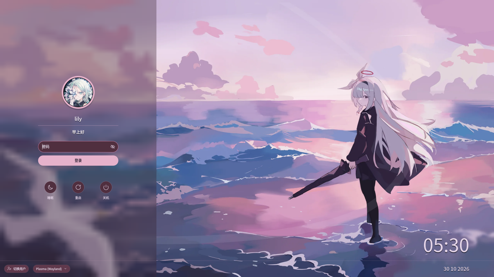

# Lily SDDM

A frosted-glass login theme for SDDM, built for Plasma 6 and Qt 6.
The accent color is derived from the current wallpaper, so the login screen
stays in tune with the background.

[中文说明](README.md)

## Preview



## Contents

- [Preview](#preview)
- [Project layout](#project-layout)
- [Installation](#installation)
- [Changing the wallpaper](#changing-the-wallpaper)
- [Compatibility and dependencies](#compatibility-and-dependencies)
- [License](#license)

## Project layout

```text
Main.qml                  theme UI and login logic
theme.conf                colors, fonts and asset paths
metadata.desktop          SDDM theme metadata
Makefile                  checks, installation, previews and release targets
PKGBUILD                  Arch packaging script
CHANGELOG.md              version history
debian/                   Debian, Ubuntu and KDE neon packaging metadata
packaging/
  README.md               distribution packaging notes
  rpm/lily-sddm-plasma6.spec
                          Fedora and openSUSE RPM spec
assets/
  wallpaper.webp          default wallpaper
  preview.png             lightweight KCM preview
  icons/                  theme SVG icons
prototype/
  index.html              HTML layout prototype
  styles.css              prototype visuals and motion
  app.js                  prototype interactions
NOTE/
  DESIGN_SPEC.md          visual and layout specification
  DEVELOPMENT.md          compatibility, preview and release notes
docs/preview.png          full-size preview
scripts/
  lib-check.sh            shared check helpers
  check-theme.sh          QML, metadata and asset checks
  check-packaging.sh      packaging metadata and install-tree checks
  check-prototype.sh      HTML/CSS/JavaScript checks
  check-layout.py         multi-resolution layout checks
  preview.sh              SDDM greeter test preview
  preview-prototype.sh    HTML prototype preview
  render-previews.sh      render full and KCM previews
  render-qml-preview.py   offscreen renderer
  build-source-archive.sh general source archive
  build-debian-orig.sh    Debian orig archive
LICENSE                   GPL-3.0-or-later license text
LICENSES/
  CC-BY-SA-4.0.txt        default wallpaper license text
```

## Installation

Four distribution families are supported:

- Arch, Manjaro, EndeavourOS: use the `PKGBUILD` in the repository root.
- Debian, Ubuntu, KDE neon: build a DEB with the metadata in `debian/`.
- Fedora: build an RPM with `packaging/rpm/lily-sddm-plasma6.spec`.
- openSUSE: use the SUSE conditional branch of the same RPM spec.

> Builds and login tests have only been run on Arch, Plasma 6, Qt 6.12 and
> SDDM 0.21. The Debian, Fedora and openSUSE metadata is provided but still
> needs package names, installation and SDDM login verified on those systems.

### Arch family

```bash
make check
makepkg -si
```

To build the package and install it manually:

```bash
makepkg -f
sudo pacman -U lily-sddm-plasma6-*-any.pkg.tar.zst
```

### Debian, Ubuntu, KDE neon

```bash
sudo apt install debhelper dpkg-dev make ripgrep
make dist-debian
cp dist/lily-sddm-plasma6_*.orig.tar.gz ..
dpkg-buildpackage -us -uc -b
sudo apt install ../lily-sddm-plasma6_*_all.deb
```

This requires Plasma 6 and a Qt 6 SDDM on the target system. Plasma 5
installations are not supported.

### Fedora

```bash
sudo dnf install rpm-build make ripgrep qt6-qtdeclarative-devel
make dist
rpmbuild -ba packaging/rpm/lily-sddm-plasma6.spec \
    --define "_sourcedir $PWD/dist"
sudo dnf install ~/rpmbuild/RPMS/noarch/lily-sddm-plasma6-*.rpm
```

### openSUSE

```bash
sudo zypper install rpm-build make ripgrep qt6-declarative-devel
make dist
rpmbuild -ba packaging/rpm/lily-sddm-plasma6.spec \
    --define "_sourcedir $PWD/dist"
sudo zypper install ~/rpmbuild/RPMS/noarch/lily-sddm-plasma6-*.rpm
```

Packaging requirements, checks, source archives and the AUR release process
are documented in
[packaging/README.md](packaging/README.md).
After installation, select the Lily theme under "Login Screen (SDDM)" in
Plasma System Settings. The theme preview comes from `assets/preview.png`
inside the package.

## Changing the wallpaper

Select the current theme and a background image under "Login Screen (SDDM)"
in Plasma System Settings. `sddm-kcm` copies the image into the theme
directory and writes `theme.conf.user`.

The blurred side rail and the automatic colors take effect the next time the
greeter starts.

The default wallpaper is Breeze Next (Hanabi) by Krystian Zajdel, licensed
under CC-BY-SA-4.0.

## Compatibility and dependencies

Tested environment:

- SDDM 0.21.0-7
- Qt 6.12.0
- Plasma 6.8.2
- Greeter: `/usr/bin/sddm-greeter-qt6`

The Qt Quick Effects QML module and the Qt SVG image plugin are required at
runtime. Each distribution package declares the matching dependencies.

The theme does not use Kirigami, PlasmaComponents, Breeze Components,
Qt Quick Controls or `Qt5Compat.GraphicalEffects`. The blurred side rail is
produced by `MultiEffect` at runtime.

After a wallpaper is selected, the greeter samples a `64x36` thumbnail once,
derives the accent color and the glass tint from it, and builds the
low-saturation dark surfaces and borders of the input field, action buttons,
session control and dialogs from the same hue. Text, error and primary button
colors stay fixed to keep contrast. `autoColors=false` disables all automatic
colors; `autoSurfaceColors=false` keeps the automatic accent while using the
fixed surface colors from `theme.conf`.

`make check` validates the four packaging metadata sets, the shared install
tree and the license, and additionally checks the layout at 720p, 1440p, 4K,
ultrawide and portrait when PySide6 is installed.
`make render-preview` regenerates the full preview and the lightweight KCM
preview with optional PySide6 and ImageMagick. It is not part of the greeter.

## License

The project code and icons are licensed under `GPL-3.0-or-later`. The default
wallpaper is Breeze Next (Hanabi) by Krystian Zajdel, licensed under
CC-BY-SA-4.0. The full GPL text is in `LICENSE`, and packages install it to
`/usr/share/licenses/lily-sddm-plasma6/`.
